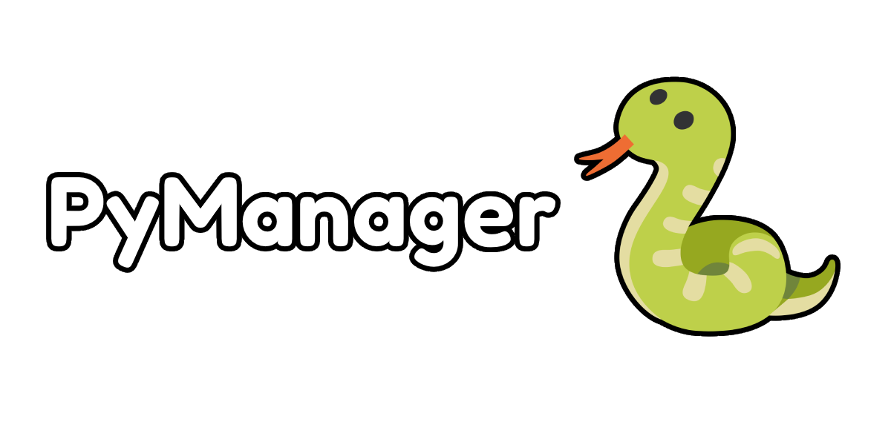

# PyManager

Application Windows (PyQt5) pour voir, ajouter et gérer les installations Python de ton ordinateur
et leurs bibliothèques (pip).

# Fonctionnalités

- Détection de `python.exe` automatiquement sur l'ordinateur.
- Gestion des bibliothèques : les réparer, les mettre à jour ou les désinstaller.
- Réparation de pip : s'il y a un problème avec pip, PyManager propose de le réinstaller.
- Personnalisable : raccourcis (Bureau / menu Démarrer) et 10 langues, dans le bouton ⚙ Paramètres.

# Racine de chemin

Tous les fichiers sont créés à côté de l'application (ou dans `%APPDATA%\PyManager` si le dossier n'est pas modifiable).

| Fichier | Contenu |
|---|---|
| `settings.json` | Thème et langue choisis |
| `pythons.json` | Python ajoutés / retirés manuellement |
| `pip_install.log` | Journal des installations de pip (utile en cas d'échec) |

# Langue

Choix dans Paramètres → Langue : Français, English, Español, Deutsch, Português, Italiano, Nederlands, Русский, 中文, 日本語.
Au premier lancement, la langue de Windows est utilisée si elle fait partie de la liste (sinon l'anglais). Après un changement,
PyManager propose de redémarrer.

# Dépannage

| Problème | Solution |
|---|---|
| Le bouton « Réinstaller pip » n'apparaît pas | Il n'existe que pour les Python embeddable (`python3xx._pth`) sans pip |
| Un Python **Microsoft Store** n'apparaît pas | Installe-le depuis le Store : seuls les Python réellement installés sont listés |
